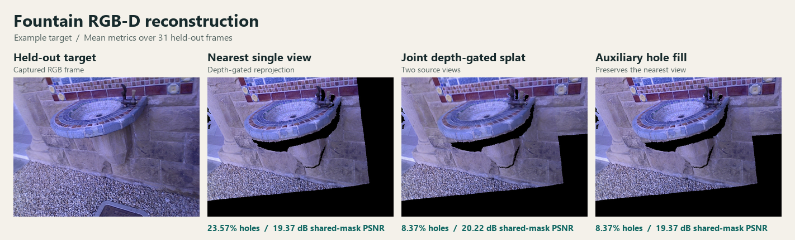

# RGB-D 新视角重投影 · RGB-D Novel-view Reprojection

这个 C++17 项目将带深度的彩色图像投到指定视角，包含 Fountain 双视角融合与 iPhone 网格投影和深度修复。每个像素先用深度和相机内参定位到三维空间，再按位姿换算到目标相机。两帧都投到同一像素时，只混合靠近最前表面的颜色。辅视角覆盖的区域可以补上主视角留下的空洞。在 Fountain 实拍序列留出的 31 个目标帧上，相比最近单视角，双视角融合将平均空洞率从 **23.57% 降至 8.37%**，相对下降 **64.5%**。



## 运行

```bash
g++ -std=c++17 -O2 -Wall -Wextra -Werror -pedantic main.cpp vendor/tinyrenderer/tgaimage.cpp -Ivendor/tinyrenderer -o rgbd_demo
./rgbd_demo results
```

Windows 装有 MSVC 时可从 **Developer Command Prompt** 编译。

```bat
cl /nologo /std:c++17 /O2 /EHsc /Ivendor\tinyrenderer main.cpp vendor\tinyrenderer\tgaimage.cpp /Fe:rgbd_demo.exe
rgbd_demo.exe results
```

复现 Fountain 实拍验证需要 Python、NumPy 和 Pillow。下载并解压 [Open3D Fountain 样例](https://github.com/isl-org/open3d_downloads/releases/download/20220201-data/SampleFountainRGBDImages.zip)，官方样例 MD5 为 c6c1b2171099f571e2a78d78675df350。把含 image、depth 和 scene/key.log 的目录传给转换脚本。

```bash
python prepare_fountain.py /path/to/extracted/fountain packed
./rgbd_demo --multiview packed results/fountain
python make_preview.py results/fountain
```

转换脚本按官方文件顺序配对 33 帧彩色图、毫米深度与 camera-to-world 位姿，保留缺失深度。样例内参为 fx = fy = 525、cx = 319.5、cy = 239.5，分辨率为 640 × 480。位姿日志的旋转经过数值正交化。转换输出的每个 .rgbd 像素含 3 字节 RGB 和 2 字节小端深度。运行融合时，只有两帧邻帧及相机参数参与投影，目标帧的 RGB 与深度用于计算指标。

## 实拍对照

逐帧以编号 1–31 的每帧为目标，取前后相邻帧为源图。两组单视角对照按相机中心离目标更近和更远区分，使用与融合相同的双线性权重和 4 cm 深度门控。联合投影把两组样本投进同一个深度缓冲，只混合距离最近样本 4 cm 以内的颜色。另做仅补洞对照，把辅助帧重投影填到主帧的空洞处，保留主帧已有结果。

| 方法 | 平均空洞率 | 深度误差 ≤5 cm 的覆盖率 | 共同有效区域 PSNR |
| --- | ---: | ---: | ---: |
| 最近单视角 | 23.57% | 71.28% | 19.37 dB |
| 较远单视角 | 31.16% | 64.90% | 18.84 dB |
| 双视角联合投影 | 8.37% | 85.29% | 20.22 dB |
| 辅视角仅补洞 | 8.37% | 85.35% | 19.37 dB |

先逐帧计算各项指标，再对 31 帧取算术平均。空洞率和深度一致覆盖率的分母为目标帧有实测深度的像素数。PSNR 使用同一掩膜，该区域同时具备目标有效深度和两个单视角的有效预测。两个融合对照的覆盖范围相同，联合投影还会更新两帧都覆盖区域的颜色。逐帧数据见 [multiview.csv](results/fountain/multiview.csv)。

Fountain 提供的是估计相机轨迹。对照覆盖一条实拍序列，使用固定阈值。空洞包含视野差异、遮挡及源深度缺失。两帧都未看到的区域仍会留空，深度不准或位姿偏差可能带来重影。深度一致性以传感器测量为参考。这个项目展示已有重投影和可见性处理方法的实现及评测。

## iPhone 实拍网格重投影与深度修复

在 ECCV PhysAI 配套的 iPhone 本地验证集上，用五段视频共 245 对实拍帧评估。渲染输入为源 RGB、源 LiDAR 深度及两个视角的内参与位姿。目标 RGB 和官方 `valid & covisible` 掩膜只用于评分。比赛榜单采用独立的隐藏测试集。 [iPhone 验证协议](https://github.com/NIRVANALAN/eccv26-physai-workshop-vdm_nvs_bench/blob/main/docs/iphone_nvs_validation.md) · [比赛主页](https://phys-ai-workshop.github.io/eccv26/challenge.html)

- **网格投影**。在源深度图上按较小的深度差选择对角线，剔除跨深度断层的三角形。目标视角使用透视正确插值和 z-buffer，孤立的可见点由原有点投影补充。
- **深度修复**。源 LiDAR 缺测时，用颜色与深度相近的实测邻点拟合局部逆深度平面。支持点、拟合残差和深度幅度都通过检查后，只用候选几何填目标视角尚未覆盖的像素。

### 对照与结果

- **原分辨率 512 × 288**。以原有 2 × 2 深度门控双线性点投影为基线。网格＋深度修复将 mPSNR 从 **8.4016 提升到 8.6105 dB（+0.2089 dB）**，掩膜覆盖率从 **53.72% 升到 57.12%（+3.40 个百分点）**。计算耗时从 **23.4 ms/帧 增至 93.6 ms/帧**。仅加有门控网格时为 8.4043 dB、43.7 ms/帧。
- **半分辨率源输入 256 × 144**。对源 RGB-D 等间隔抽样，目标图和掩膜保持 512 × 288。固定 2 × 2 支持范围的基线得 7.6247 dB。以支持范围最多为 4 × 4 的尺度感知点投影作为更强基线，网格＋深度修复将 mPSNR 从 **8.4822 提升到 8.6409 dB（+0.1587 dB）**，覆盖率从 **54.59% 升到 57.36%（+2.77 个百分点）**，耗时从 **12.8 ms/帧 增至 43.6 ms/帧**。仅加有门控网格时为 8.4685 dB、24.0 ms/帧。

mPSNR 在官方掩膜上统计，未覆盖像素按黑色计入。先在每段视频的 49 帧内汇总平方误差并计算 PSNR，再对五段视频等权平均。覆盖率为掩膜内有效渲染像素比例，同样对五段等权平均。两种分辨率的增益主要来自深度修复增加覆盖。共同有效区为所有方法在官方掩膜内的覆盖交集。原分辨率的共同有效区域 PSNR 为 16.14 → 16.04 dB，半分辨率相对尺度感知基线为 16.34 → 16.08 dB。跨视角的大面积遮挡、视野之外的内容仍可能留空。

计时为 Windows x64 CPU、GCC 16.2 `-O2` 下用 C++ 稳定时钟测得的平均计算时间。包含投影、相应的绘制和深度修复，排除解码、读写及评分。两组实验在同一台机器并行运行，数值用于各组内部对照。

- 原分辨率 [分片段指标](results/iphone/native/per_clip.csv) · [逐帧指标](results/iphone/native/per_frame.csv)
- 半分辨率 [分片段指标](results/iphone/half/per_clip.csv) · [逐帧指标](results/iphone/half/per_frame.csv)

### 本地复现与数据来源

从 [ECCV PhysAI 数据页](https://huggingface.co/datasets/yslan/ECCV26_PhysAI_Challenge_NVS_Syn4D_subset) 下载并解压 `iphone_nvs_validation_bundle.tar.gz`。本次使用的归档 SHA-256 为 `aa12ef9cff2542fff051a260eeb8870872e211b561ef57f66debbb2e75b3ec0d`。按上文编译 C++17，准备 FFmpeg 和 Python 的 `numpy`、`pillow`、`scikit-image`。

```bash
python evaluate_iphone.py --bundle iphone_nvs_validation_bundle --executable ./rgbd_demo --output results/iphone/native
python evaluate_iphone.py --bundle iphone_nvs_validation_bundle --executable ./rgbd_demo --output results/iphone/half --source-stride 2
```

Windows 下把 `--executable` 指向 `rgbd_demo.exe`。FFmpeg 未加入 PATH 时可用 `--ffmpeg` 指定路径。脚本会在本地输出 `per_clip.csv`、`per_frame.csv` 和 `preview.png`。

iPhone 素材来自 DyCheck，经 Shape of Motion 处理，由 ECCV PhysAI 打包用于公开本地验证。发布页标注 CC BY-NC 4.0，其中许可段落明确提及 Syn4D。本仓库公开的是实现、评测脚本与计算所得指标，iPhone 数据与含实拍像素的预览由本地复现。 [DyCheck 数据说明](https://github.com/KAIR-BAIR/dycheck/blob/main/docs/DATASETS.md) · [Shape of Motion](https://github.com/vye16/shape-of-motion) · [数据页许可说明](https://huggingface.co/datasets/yslan/ECCV26_PhysAI_Challenge_NVS_Syn4D_subset#license--attribution)

## 合成回归

保留两组独立光线求交场景的单视角对照。六次位姿变化中，最近邻和双线性平均空洞率分别为 11.20% 和 8.40%，深度门控在共同有效区的平均 PSNR 从普通双线性的 23.69 dB 升至 24.26 dB。程序保留同位姿逐像素检查及前后景重叠检查，逐项结果见 [metrics.csv](results/metrics.csv)。安装 Pillow 后运行 python make_preview.py results 可更新合成对照图。

## 来源

- 项目选题参考 [鼠鼠实习妙妙工具](https://github.com/LiuMengxuan04/shushu-internship-tool/)。图像读写复用 [TinyRenderer 的 TGA 模块](https://github.com/ssloy/tinyrenderer/tree/97eb7a480e762285899a93c5d21e70a79e60782e)，原许可证见 vendor/tinyrenderer/LICENSE.txt。重投影、深度门控与评测代码由 Codex 辅助编写和验证。
- Fountain 为 Zhou 和 Koltun 的实拍 RGB-D 序列，引用论文为 *Color Map Optimization for 3D Reconstruction with Consumer Depth Cameras*，SIGGRAPH 2014。[原始数据和标定说明](https://qianyi.info/scenedata.html) · [Open3D 样例文档](https://www.open3d.org/docs/latest/python_api/open3d.data.SampleFountainRGBDImages.html)
